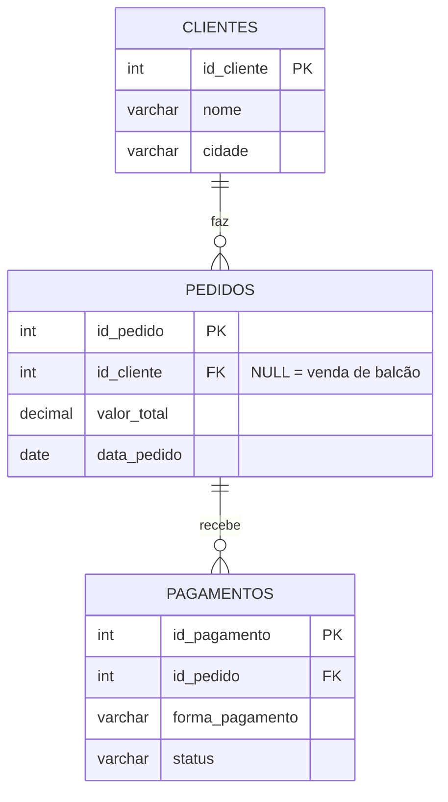

# 🛒 Prática de SQL JOINs · Loja

15 consultas sobre um banco simples de loja (clientes, pedidos e pagamentos), divididas em três níveis de dificuldade. As consultas cruzam as tabelas para responder perguntas de negócio: quem comprou, quais pedidos estão sem pagamento, quanto cada cliente gastou e quais vendas foram feitas sem cliente cadastrado (vendas de balcão).


## Modelo de dados



- Um pedido pode não ter cliente (`id_cliente` NULL), que é o caso das vendas de balcão.
- Não existe ligação direta entre `clientes` e `pagamentos`: o caminho sempre passa por `pedidos`.
- Nos dados de exemplo, os pedidos 103 e 105 não têm pagamento cadastrado.

## Scripts

| Arquivo | O que faz |
|---|---|
| [`01-criacao-banco.sql`](01-criacao-banco.sql) | Cria o banco `db_loja_completa`, recria as 3 tabelas com as chaves e insere os dados de exemplo |
| [`02-exercicios-joins.sql`](02-exercicios-joins.sql) | As 15 consultas da lista |

## Exercícios

| Módulo | # | Consulta | Técnica |
|---|---|---|---|
| **1 · Básico** | 1 | Clientes e seus pedidos | `INNER JOIN` |
| | 2 | Todos os clientes, com ou sem pedido | `LEFT JOIN` |
| | 3 | Todos os pedidos, com ou sem cliente | `RIGHT JOIN` |
| | 4 | Pedidos que têm pagamento | `INNER JOIN` |
| | 5 | Clientes que nunca compraram | `LEFT JOIN` + `IS NULL` |
| **2 · Intermediário** | 6 | Status de pagamento de cada pedido | `LEFT JOIN` |
| | 7 | Vendas de balcão | `WHERE ... IS NULL` |
| | 8 | Total gasto por cliente | `INNER JOIN` + `SUM` + `GROUP BY` |
| | 9 | Total gasto incluindo quem não comprou | `LEFT JOIN` + `SUM` |
| | 10 | Quantidade de pedidos por cidade | `COUNT(coluna)` + `GROUP BY` |
| **3 · Avançado** | 11 | Cliente → pedido → pagamento (só completos) | `JOIN` triplo |
| | 12 | Funil completo, mostrando as lacunas | `LEFT JOIN` triplo |
| | 13 | Pedidos de clientes sem pagamento (inadimplência) | `LEFT JOIN` + `IS NULL` + coluna fixa |
| | 14 | Pagamentos com nome do cliente ou "Cliente Não Identificado" | `UNION` |
| | 15 | Todos os clientes e todos os pedidos | `FULL OUTER JOIN` simulado com `UNION` |

### Exemplo de resultado: exercício 15

O MySQL não tem `FULL OUTER JOIN`. A consulta junta um `LEFT JOIN` com um `RIGHT JOIN` usando `UNION`:

| nome | id_pedido | valor_total |
|---|---|---|
| Ana Silva | 101 | 150.50 |
| Ana Silva | 102 | 89.90 |
| Bruno Costa | 103 | 210.00 |
| Carla Dias | NULL | NULL |
| Diego Lima | NULL | NULL |
| NULL | 104 | 45.00 |
| NULL | 105 | 300.00 |

## Como executar

1. No **MySQL Workbench**, abra o `01-criacao-banco.sql` e execute o script inteiro (`Ctrl + Shift + Enter`).
2. Abra o `02-exercicios-joins.sql` e rode uma consulta por vez: coloque o cursor dentro dela e aperte `Ctrl + Enter`.
3. Para recomeçar do zero, rode o `01-criacao-banco.sql` de novo.

Pelo terminal:

```bash
mysql -u root -p < 01-criacao-banco.sql
mysql -u root -p --table < 02-exercicios-joins.sql
```

## Conceitos praticados

`INNER`, `LEFT` e `RIGHT JOIN` · JOIN com 3 tabelas · busca de registros sem correspondência · `SUM` e `COUNT` (`COUNT(*)` × `COUNT(coluna)`) · `GROUP BY` e `ORDER BY` · coluna com texto fixo · `UNION` e simulação de `FULL OUTER JOIN` · chaves primárias e estrangeiras

## Notas

- **Exercício 7:** foi resolvido com filtro direto (`id_cliente IS NULL`), sem JOIN. Funciona com esses dados, mas a versão com `LEFT JOIN` + `IS NULL` também pegaria pedidos que apontam para um cliente inexistente.
- **Exercícios 8 e 9:** agrupam por `nome`. Se dois clientes tivessem o mesmo nome, os valores deles seriam somados juntos. Agrupar por `id_cliente, nome` evitaria isso.
- **Exercício 15:** o `UNION` remove linhas idênticas. `UNION ALL` com um filtro na segunda parte seria mais seguro.
- As consultas sem `ORDER BY` não têm ordem de linhas garantida.
